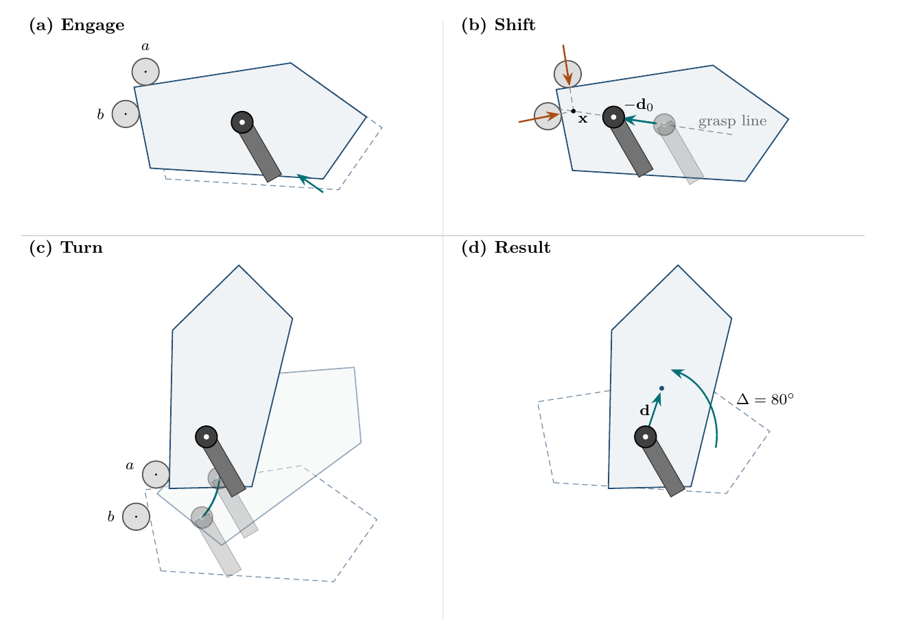

# Shift, Then Turn: Planar In-Grasp Manipulation with Two Passive Rods

Pierre-Olivier Bolduc, Clément Gosselin, 2026. **[Paper (PDF)](paper/main.pdf)**

This repository holds the paper and the code behind it: the MuJoCo simulations of
shifts, turns and complete sequences, the closed-form predictions they are compared
with, and the constructions behind the paper's geometric figures.

[](paper/main.pdf)

Changing the grasp with two rods (Figure 1 of the paper). (a) The gripper brings the
plate against two rods that spin freely on bearings. (b) The rod forces meet on the
grasp line, so the plate stays still while the gripper slides along it. (c) The gripper
orbits rod $a$; the plate turns within the grip and separates from rod $b$. (d) In the
gripper frame, the plate has turned by $\Delta=80^\circ$ and shifted by the requested
$\mathbf d$.

## Abstract

Parallel grippers are reliable and inexpensive, but once they pinch an object they cannot
change its pose within the grasp. Rather than adding sensing, finger actuation, or
contact-rich planning, we add passive geometry to the robot's workspace, and we show that
this geometry can be designed in closed form. The design starts from what passive contacts
can and cannot do: they cannot determine a motion that both slides and turns the object in
the grip, so a planar change of grasp is executed as a shift, during which the tool holds
the object while the gripper slides along it, followed by a turn, during which the gripper
orbits one contact while the grasp holds. Two rods spinning freely on bearings provide both
motions. Two rods are the fewest that hold an arbitrary shift; one of them then guides the
turn, and the other separates by itself. The rod placement is a projection at one vertex of
a convex or nonconvex polygonal outline, the gripper path is a segment followed by a
circular arc, and a single quadratic equation tells whether an installed pair can serve a
request. No friction coefficient or grip-force value enters the design, no sensing is used
during the manipulation motion, and because the rods spin freely, grasp slip during the
turn is predicted from the pad size and the lever arm alone. Hardware turns on a Kinova
Jaco reached mean absolute errors of 3.6°–7.5°; in simulation, complete sequences ended
within 1.6° and 0.44 mm of the request, and the measured tilt, slip, and separation agreed
with the closed-form predictions.

## Setup

Python 3.13:

```powershell
python -m venv .venv
.venv\Scripts\Activate.ps1
python -m pip install -r requirements.txt
```

## Commands

`python -m simulation` lists its commands; append `--help` to any of them. `run` writes
to `results/` (overwriting the saved runs); `tables`, `figures` and `python -m geometry`
write into `paper/`. In the order used for the paper:

```powershell
python -m simulation run        # 367 MuJoCo runs -> results/simulation.json (about 2 min, 6 workers)
python -m simulation tables     # paper/tables/sim-turn.tex, sim-sensing.tex
python -m simulation figures    # paper/figures/sim-shift.tex, sim-turn.tex
python -m geometry              # paper/figures/tworod-example.tex, holding.tex, approach.tex
```

`run --workers N` sets the number of parallel processes. `tables` and `figures` read only
the saved results, so they can be rerun without the simulations. `geometry` checks the
contact conditions of the approach figure as it writes it. Simulation values quoted in
the text are taken from `results/simulation.json` by hand.

Tests: `python -m unittest discover -s tests -t .`. They check the closed-form
predictions against their limits and the values quoted in the paper, that
`results/simulation.json` holds one complete run for every case in the code, and that
every generated table and figure in `paper/` is exactly what the code and the saved
results produce. They do not rerun the simulations. Lint with
`python -m pip install -e .[dev]`, then `ruff check` and `ruff format --check`.

## Building the paper

Requires a TeX distribution with `latexmk`, pdfLaTeX and BibTeX. From `paper/`:

```sh
latexmk main.tex
```

The PDF is written to `paper/main.pdf`. Auxiliary files stay in `paper/build/`, which is
created automatically and can be deleted at any time. Use `latexmk -g main.tex` to force
a rebuild.

The README image `paper/figures/tworod-example.png` is Figure 1 rendered alone by
[`paper/readme-figure.tex`](paper/readme-figure.tex); the two commands to regenerate it
are at the top of that file.

The hardware photographs `paper/figures/Figure7.jpg` and `Figure8.jpg` are JPEG copies
(quality 90) of the original PNGs, which are kept locally in `paper/figures/originals/`
and not tracked. `Figure8` is printed at its full resolution; `Figure7` is resized to
1200 px wide, about 600 dpi at its printed width. With ImageMagick, from
`paper/figures/`:

```sh
magick originals/Figure7.png -resize 1200x -strip -quality 90 -sampling-factor 4:2:0 Figure7.jpg
magick originals/Figure8.png -strip -quality 90 -sampling-factor 4:2:0 Figure8.jpg
```

## Layout

The code follows the paper.

| Part | Code | Saved results | Paper sections |
| --- | --- | --- | --- |
| Shift and turn constructions and the geometric figures | [Geometry](geometry/) | Checked by the tests against the paper | [Section 1](paper/sections/1-Intro.tex), [Section 4](paper/sections/4-Shift.tex), [Section 7](paper/sections/7-Installation.tex) |
| Closed-form tilt, slip and drift predictions | [Predictions](simulation/predictions.py) | Checked by the tests against the paper | [Section 4](paper/sections/4-Shift.tex), [Section 5](paper/sections/5-Turn.tex) |
| MuJoCo simulations E1–E7 | [Simulation](simulation/) | [simulation.json](results/simulation.json) | [Section 8](paper/sections/8-Evidence.tex) |

See [the results guide](results/README.md) for the format of the saved runs. The
hardware trials of Section 8.1 are reported in the paper only; their photographs are in
`paper/figures/`.

```text
simulation/            MuJoCo simulations (Sec. 8)
  core.py                trial settings, sensors and gripper commands
  model.xml              MuJoCo scene: plate, rods on bearings, gripper
  experiments.py         MuJoCo plant, the E1-E7 cases and the parallel runner
  predictions.py         the paper's closed-form predictions for the simulated plate
  tables.py              paper/tables/sim-*.tex
  figures.py             paper/figures/sim-*.tex
  store.py               file locations, saving and loading results
geometry/              the geometric figures
  construction.py        rod placement across the trailing vertex, stiffness, lever arms
  tworod.py              tworod-example.tex (Fig. 1): engage, shift, turn, result
  holding.py             holding.tex: one rod, two rods on an edge, across a vertex
  approach.py            approach.tex: collision-free approach (shapely offsets)
tests/
results/               simulation.json, the runs the paper reports
paper/
  main.tex, refs.bib, readme-figure.tex
  sections/, style/
  figures/             TikZ figures, the MuJoCo render (Figure6.png) and the hardware
                       photographs (Figure7.jpg, Figure8.jpg); figure-styles.tex and
                       experiment-sequences.tex are written by hand, the others by
                       python -m simulation figures and python -m geometry
  tables/              written by python -m simulation tables
```

## How to cite

```bibtex
@misc{bolduc2026shift,
  author = {Bolduc, Pierre-Olivier and Gosselin, Cl{\'e}ment},
  title  = {Shift, Then Turn: Planar In-Grasp Manipulation with Two Passive Rods},
  year   = {2026},
  month  = oct
}
```

See also [`CITATION.cff`](CITATION.cff).

## License

- Code (`simulation/`, `geometry/`, `tests/`) and saved results: MIT; see [LICENSE](LICENSE).
- Paper (`paper/`: text, figures, tables and the PDF): all rights reserved by the authors;
  see [paper/LICENSE](paper/LICENSE).
